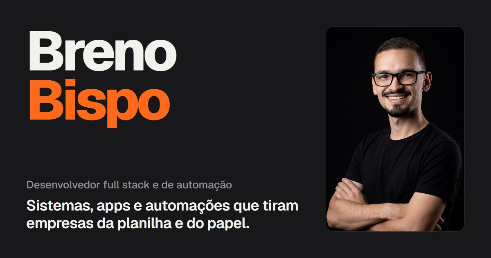

# Breno Bispo · Portfólio

Portfólio de **Breno Bispo**, desenvolvedor full stack e de automação. Reúne 26 projetos entre sistemas internos para empresas, sites para clientes, apps Android e automações, com versões em português e inglês.

**[Ver o site →](https://bbispo368.github.io/portfolio/)**



## Destaques

- **Bilíngue:** português e inglês, escolhidos pela URL (`?lang=pt` ou `?lang=en`), pela última escolha do visitante ou pelo idioma do navegador.
- **Projetos navegáveis:** grade com filtros por categoria e um painel de detalhes com galeria de telas. Cada projeto tem um link direto, como `?projeto=crm-vendas`.
- **Tema claro e escuro**, com a escolha salva no navegador.
- **Interação cuidada:** resposta imediata ao toque, painel que abre a partir do card clicado e respeito à preferência do sistema por menos movimento (`prefers-reduced-motion`).
- **Sem dependências nem build:** HTML, CSS e JavaScript puros, prontos para qualquer hospedagem estática.
- **SEO básico:** Open Graph, `canonical`, `hreflang` e `sitemap.xml`.

> Projetos feitos para empresas e clientes aparecem sem nomes, dados ou código proprietário. As capturas de tela usam dados fictícios.

## Tecnologias

| Parte | Escolha |
|---|---|
| Estrutura e estilo | HTML e CSS, com variáveis CSS para os temas |
| Comportamento | JavaScript sem frameworks |
| Tipografia | [Geist](https://vercel.com/font), via Google Fonts |
| Ícones das ferramentas | [Simple Icons](https://simpleicons.org) |
| Hospedagem | GitHub Pages |

## Rodando localmente

```bash
git clone https://github.com/BBispo368/portfolio.git
cd portfolio
```

Abra o `index.html` direto no navegador ou, para simular a hospedagem, sirva a pasta com qualquer servidor estático:

```bash
python -m http.server 8080
```

E acesse `http://localhost:8080`.

## Estrutura

```
├── index.html          Página única, com as seções e as meta tags
├── css/style.css       Estilos, com os tokens de cor e tipografia no topo
├── js/
│   ├── config.js       Dados pessoais, contatos, currículo, trajetória e depoimentos
│   ├── i18n.js         Textos da página em PT e EN
│   ├── projects.js     Projetos em português
│   ├── projects.en.js  Traduções dos projetos para o inglês
│   ├── tools.js        Ferramentas exibidas com ícone, agrupadas por área
│   └── main.js         Renderização, filtros, painel, idioma e tema
├── assets/img/         Foto, imagem de compartilhamento e telas dos projetos
├── sitemap.xml
└── robots.txt
```

## Como o conteúdo é organizado

Todo o conteúdo fica em arquivos de dados, separado do código. Mudar um texto ou incluir um projeto não exige mexer no `main.js`.

| Para mudar | Edite |
|---|---|
| Nome, foto e contatos | `js/config.js`. Campos vazios ficam ocultos no site. |
| Currículo, trajetória e depoimentos | `cv`, `timeline` e `testimonials` em `js/config.js`. Só aparecem quando preenchidos. |
| Textos da página | `js/i18n.js`, com a mesma estrutura nos dois idiomas. |
| Projetos | `js/projects.js`. O campo `kind` aceita `client`, `internal`, `personal`, `study` ou `product`, e `highlight: true` coloca o projeto entre os destaques. |
| Tradução dos projetos | `js/projects.en.js`, usando o mesmo `id` do projeto em português. |
| Estudo de caso de um projeto | `caseStudy` com `problem`, `solution`, `result` e `learned`. Cada campo vazio fica oculto. |
| Ferramentas com ícone | `js/tools.js`. O `name` precisa ser igual ao usado em `stack` nos projetos. |
| Cores e tipografia | Variáveis no topo de `css/style.css`. |

Os números da seção "Sobre" e a lista de ferramentas são calculados a partir dos projetos, então se atualizam sozinhos.

## Publicação

O site é publicado pelo GitHub Pages a partir da branch `main`. Para publicar uma cópia:

1. Em **Settings → Pages**, escolha a branch `main` e a pasta raiz (`/ (root)`).
2. Atualize o endereço do site em `index.html` (`canonical`, `hreflang` e `og:*`), em `sitemap.xml` e em `robots.txt`.

Os buscadores só leem o `robots.txt` na raiz do domínio. Num endereço como `usuario.github.io/portfolio/`, envie o `sitemap.xml` pelo Google Search Console.

## Créditos

- Ícones: [Simple Icons](https://simpleicons.org), sob licença CC0. As marcas pertencem aos seus donos.
- Fonte: [Geist](https://vercel.com/font), da Vercel, sob a SIL Open Font License.

## Contato

- **Site:** [bbispo368.github.io/portfolio](https://bbispo368.github.io/portfolio/)
- **LinkedIn:** [breno-bispo-5745411a8](https://www.linkedin.com/in/breno-bispo-5745411a8)
- **GitHub:** [@BBispo368](https://github.com/BBispo368)
